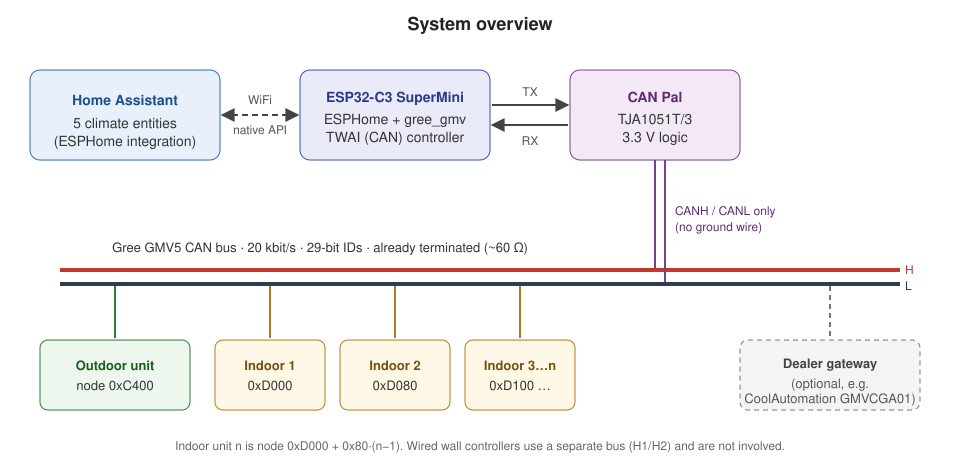
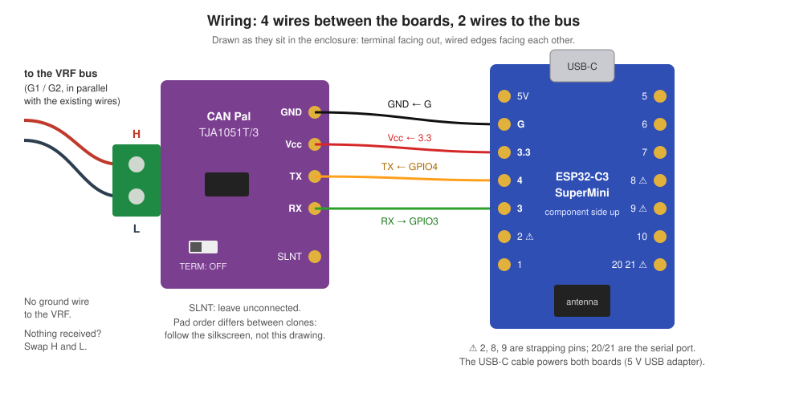
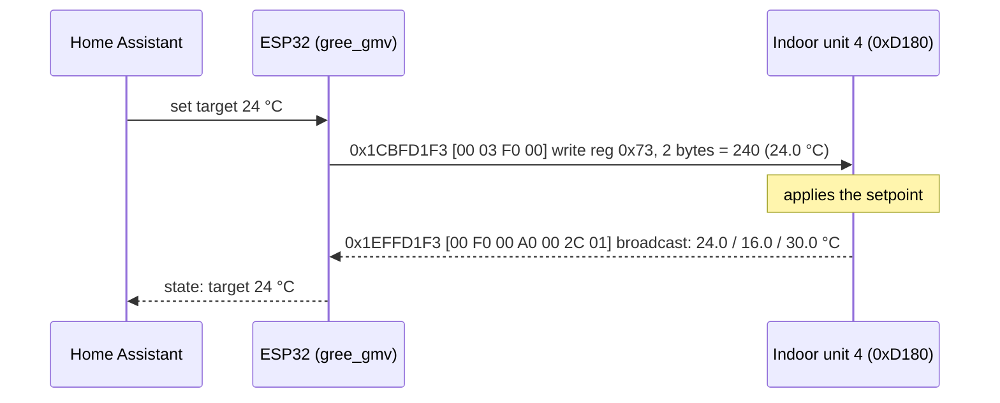
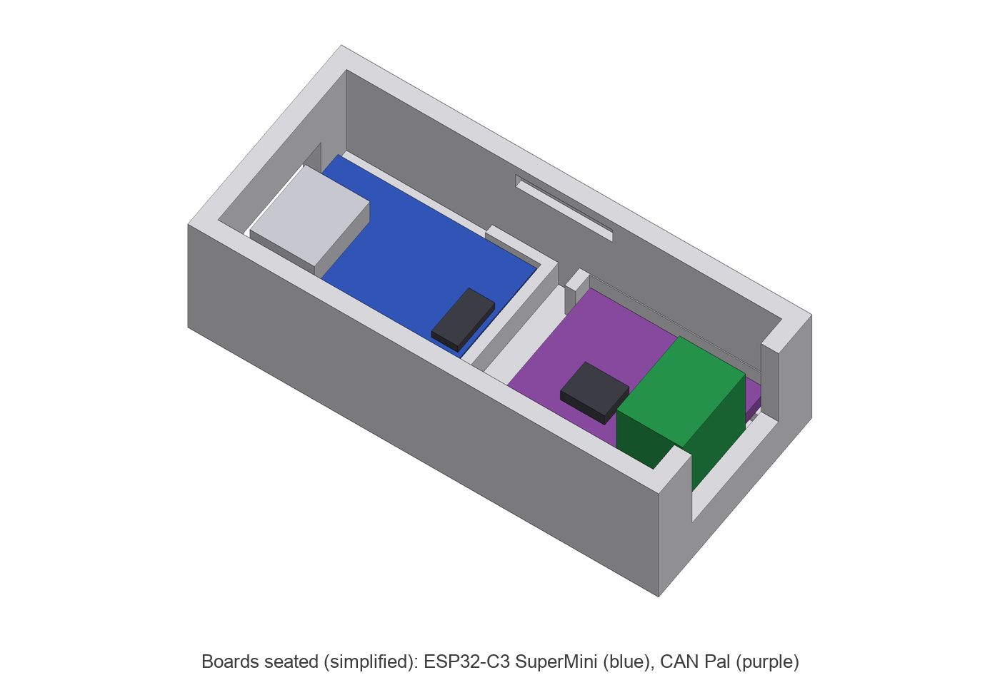
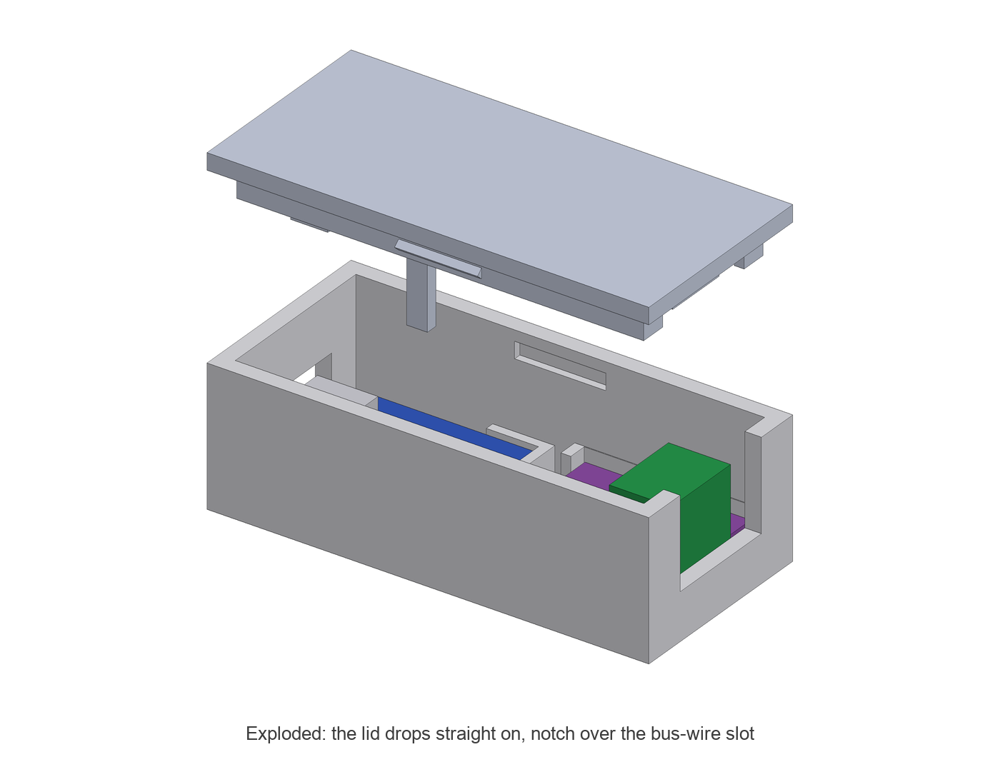
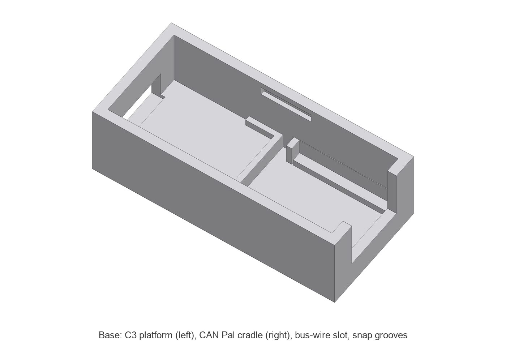
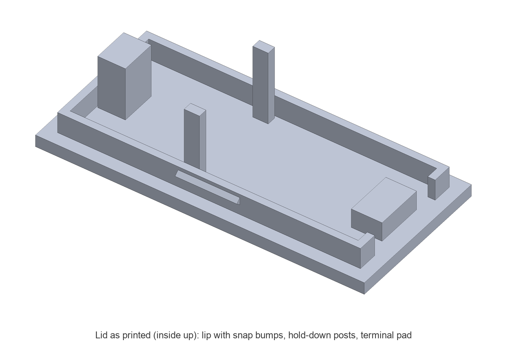
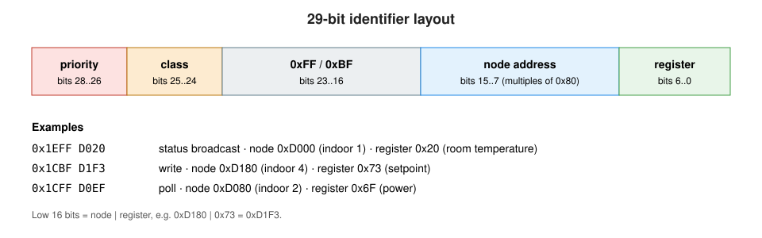

# Build guide: Gree GMV5 VRF in Home Assistant with an ESP32

Control every indoor unit of a Gree GMV5 VRF system from Home Assistant: power, mode, fan speed,
swing, setpoint and room temperature. You need about €10 of parts and no cloud. A small ESP32
board running ESPHome joins the VRF's own CAN bus with two wires and shows each indoor unit as a
`climate` entity.

| | |
|---|---|
| **Result** | One Home Assistant climate entity per indoor unit, updated live, about 0.3–1 s from tap to unit |
| **Cost** | About €10 (ESP32-C3 SuperMini + TJA1051T/3 transceiver board), plus a USB power adapter |
| **Time** | One evening for the build, plus a 3D print if you want the enclosure |
| **Skills** | Basic soldering, editing YAML, flashing ESPHome |
| **Tested on** | 1 outdoor unit + 5 indoor units, ESPHome 2026.9.1 / 2026.10.0, alongside a CoolAutomation gateway |

> [!WARNING]
> **Read this first.**
> - The bus terminals are low voltage, but **the outdoor and indoor units also carry mains voltage**,
>   sometimes in the same terminal box. If you are not qualified to open them, have your installer
>   make the two-wire connection for you. Everything else in this guide is low voltage.
> - This is reverse-engineered, unofficial and unsupported by Gree. Opening the units may affect
>   your warranty. You do this at your own risk.
> - The device only writes the same registers a commercial gateway writes (power, mode, fan,
>   swing, setpoint). Do not experiment with other registers on a system you depend on.

## Contents

1. [How it works](#1-how-it-works)
2. [Will it work on my system?](#2-will-it-work-on-my-system)
3. [Parts and tools](#3-parts-and-tools)
4. [Bench-test the transceiver](#4-bench-test-the-transceiver)
5. [Solder the two boards together](#5-solder-the-two-boards-together)
6. [Set up ESPHome and flash](#6-set-up-esphome-and-flash)
7. [Connect to the bus](#7-connect-to-the-bus)
8. [Find your indoor units](#8-find-your-indoor-units)
9. [Use it in Home Assistant](#9-use-it-in-home-assistant)
10. [Print the enclosure](#10-print-the-enclosure)
11. [Troubleshooting](#11-troubleshooting)
12. [How the protocol works](#12-how-the-protocol-works)
13. [Limitations and open questions](#13-limitations-and-open-questions)
14. [Contributing](#14-contributing)

---

## 1. How it works



The outdoor unit (ODU) and the indoor units (IDUs) of a GMV5 system talk over a **CAN bus at
20 kbit/s**. Every unit regularly broadcasts its state (room temperature, power, mode, fan,
setpoint), and anything on the bus can write a setting by sending a short frame to the unit. The
unit applies the setting and confirms it by broadcasting the new value within a second.

The ESP32's built-in CAN controller (Espressif calls it TWAI) does the protocol work. A
**transceiver** board turns the ESP32's 3.3 V TX/RX signals into the bus's differential CANH/CANL
pair. The `gree_gmv` ESPHome component in this repo turns the broadcasts into climate entities and
turns your changes in Home Assistant into write frames.

You can leave any existing controller on the bus, such as a dealer gateway, the wall controllers
or the vendor app. Changes made there show up in Home Assistant too.

---

## 2. Will it work on my system?

| Check | What you want to see |
|---|---|
| System family | Gree **GMV5** (also sold under other brands built on GMV5). Other GMV generations are untested. |
| Terminals | The ODU has a **G1 / G2** pair (centralized-controller port). The IDU-to-ODU line is **D1 / D2**. Both are CAN. Do **not** use **H1 / H2**: that is the wall-controller line, which carries power and data on one pair and is not CAN. |
| Multimeter, system running | Each bus wire measures about **2–2.5 V DC** to the unit's chassis, with a small flicker. |
| Multimeter, system **powered off** | Resistance across the pair is about **60 Ω** (two 120 Ω terminators). The bus is already terminated, so don't add another terminator. |

If you have a dealer gateway (for example the CoolAutomation **GMVCGA01** used with the iocControl
app), it is already wired to G1/G2. The easiest tap point is its bus terminals: connect in parallel
with its two wires. That is how this guide was built and tested.

> [!NOTE]
> Some CoolAutomation gateways are licensed **"Cloud Only"** and refuse their local API. That is why
> this project exists. If yours has a local API (`nc <gateway-ip> 10102`, then type `ls2`), Home
> Assistant's built-in CoolMasterNet integration may be all you need.

---

## 3. Parts and tools

### Parts

| Part | Notes |
|---|---|
| **ESP32-C3 SuperMini** | Tiny, cheap, has a CAN (TWAI) controller and can do 20 kbit/s. Other ESP32s work too, see the note below. |
| **TJA1051T/3 transceiver board** | The Adafruit **CAN Pal** (product 5708) or a clone. It must have **3.3 V logic**. The clone used here has the chip marked `NXP A1051/3` and an on-board charge pump that makes 5 V for the bus side from 3.3 V. |
| 4 short wires | Thin solid or stranded wire, about 26–30 AWG. |
| 2-wire cable to the bus | Any low-voltage pair, as short as practical. |
| USB-C cable + 5 V USB power adapter | Powers both boards. |
| Optional: 100 Ω resistor | For the bench test in step 4. |
| Optional: 3D-printed enclosure | STL generator in `enclosure/`, see step 10. |

> [!CAUTION]
> **Avoid "SN65HVD230" modules from marketplaces.** We bought two batches from different listings,
> and both were 5 V transceiver dies relabelled as SN65HVD230. At 3.3 V they **receive perfectly but
> cannot transmit**. You only find out when your writes fail, which cost us days. A genuine
> SN65HVD230 (for example Waveshare's board) is fine. Whatever you buy, run the
> [bench test](#4-bench-test-the-transceiver) before it goes near the bus.

**Other ESP32 boards.** Any ESP32 with TWAI works: classic ESP32, S3, C3 or C6. A classic ESP32
needs silicon revision ≥ 2 for 20 kbit/s. The bundled driver override handles that, and you must set
`esp32.framework.advanced.minimum_chip_revision` to your chip's revision. The original proof of
concept ran on an ESP32-WROOM-32D (TX GPIO26, RX GPIO27). With another board, change `board:`,
`tx_pin:` and `rx_pin:` in the config.

### Tools

- Soldering iron, flux, thin solder
- Multimeter
- A computer with [ESPHome](https://esphome.io/guides/installing_esphome) (CLI or the Home Assistant add-on)
- Optional: a 3D printer

---

## 4. Bench-test the transceiver

Do this **before connecting anything to the VRF**. It takes five minutes and catches fake
transceivers.

1. Wire the two boards as in [step 5](#5-solder-the-two-boards-together). For the test you can tack
   the wires on or use jumpers.
2. Put a **100 Ω resistor across CANH and CANL** on the transceiver's terminal. It stands in for a
   real bus load.
3. Flash the diagnostic config `esphome/c3-tx-loop-test.yaml`:
   ```bash
   cd esphome
   cp secrets.yaml.example secrets.yaml   # then fill in your WiFi
   esphome run c3-tx-loop-test.yaml
   ```
   Every 2 s, it pulls TX low for 30 µs ten times and checks whether the receiver sees the bus go
   dominant.
4. Read the log:

   | Log line | Meaning |
   |---|---|
   | `rx low while idle: 0/50   rx low while tx driven low: 10/10` | **Pass.** The transceiver can drive a loaded bus. |
   | `... tx driven low: 0/10` | **Fail.** It cannot drive 100 Ω. This is the fake-SN65HVD230 signature, or a wiring fault on TX. |

> [!TIP]
> Don't test with TX held low for seconds. The TJA1051 has a dominant timeout of a few ms and
> releases the bus on purpose, so a long hold "fails" on a perfectly good chip. Short pulses, as the
> test config uses, are the right test.

---

## 5. Solder the two boards together



| ESP32-C3 SuperMini pad | CAN Pal pin | Wire |
|---|---|---|
| **G** | GND | black |
| **3.3** | Vcc | red |
| **4** (GPIO4) | TX | orange |
| **3** (GPIO3) | RX | green |
| — | SLNT | **leave unconnected** (the board keeps the chip in normal mode) |

The bus connects to the CAN Pal's screw terminal: **H** and **L**.

- **Termination switch: OFF.** The VRF bus is already terminated at both ends. A third terminator
  adds load and can cause errors.
- **No ground wire to the VRF.** Only CANH and CANL go to the bus. The transceiver works within a
  ±12 V common-mode range. On our system, the C3's GND measured 1.3–2.0 V from CANL, well inside
  that range. An earlier build with a ground wire to the gateway behaved the same.
- **Vcc goes to 3.3 V, not 5 V.** On this board, Vcc is also the logic supply, and the on-board
  charge pump makes the 5 V for the bus side.
- **Pins to avoid on the C3 SuperMini:** 2, 8, 9 (strapping pins: the board may not boot) and
  20, 21 (serial).
- **Solder wires directly to the pads (no headers)** if you plan to use the enclosure. Size the
  wires so the boards can sit **5–6 mm apart edge to edge** with a little slack. The enclosure's
  gap is set for that; if your wires are longer, change `GAP` in `enclosure/vrf_box.py`.

---

## 6. Set up ESPHome and flash

### 6.1 Secrets

```bash
cd esphome
cp secrets.yaml.example secrets.yaml
openssl rand -base64 32        # paste the output as vrf_api_key
```

`secrets.yaml` is git-ignored. Keep it that way.

### 6.2 The device config

`esphome/vrf.yaml` is the complete config. The important parts:

```yaml
esp32:
  board: esp32-c3-devkitm-1        # ESP32-C3 SuperMini
  framework:
    type: esp-idf

wifi:
  ssid: !secret wifi_ssid
  password: !secret wifi_password
  output_power: 8.5dB              # SuperMini quirk, see troubleshooting

external_components:
  - source: github://jbasila/gree-gmv-esp32@main
    refresh: 10min

canbus:
  - platform: esp32_can
    id: vrf_can
    tx_pin: GPIO4
    rx_pin: GPIO3
    can_id: 0
    bit_rate: 20KBPS

gree_gmv:
  canbus_id: vrf_can

climate:
  - platform: gree_gmv
    name: "Living Room"
    address: 0xD000                # indoor unit 1
  - platform: gree_gmv
    name: "Bedroom 1"
    address: 0xD080                # indoor unit 2
  # ... one entry per indoor unit, 0xD000 + 0x80 * (n - 1)
```

For the first flash you don't need to know the addresses. Leave `climate:` out, or keep the
guesses: [step 8](#8-find-your-indoor-units) finds them for you.

> [!NOTE]
> **Why the repo ships its own `esp32_can`.** Stable ESPHome up to 2026.10 has no bus-off recovery:
> one failed transmit stops reception until a reboot. It also rejects 20 kbit/s on a classic ESP32.
> `external_components` loads a patched copy of the stock driver from `components/esp32_can/`. Both
> fixes are on ESPHome's dev branch. From 2026.11 stable on, you can restrict the import to
> `components: [gree_gmv]`.

### 6.3 First flash over USB

```bash
esphome run vrf.yaml
```

- **macOS:** the first time you plug in the board, approve the *"Allow accessory to connect?"*
  prompt. Otherwise no `/dev/cu.usbmodem*` port appears.
- If you switch an existing config from a classic ESP32 to the C3, run `esphome clean vrf.yaml`
  once. Otherwise stale compiler flags fail the build with
  `unrecognized command-line option '-mlongcalls'`.
- After the first flash, updates go over WiFi (OTA).

Using the Home Assistant ESPHome add-on? Paste the same YAML into a new device there, and keep that
copy in sync with your local one. See [troubleshooting](#11-troubleshooting) for what happens when
the two get out of sync.

---

## 7. Connect to the bus

1. **Power down the VRF** if you have to open a unit to reach the terminals, or ask your installer.
2. Run a short two-wire cable from the CAN Pal's **H / L** terminal to the **G1 / G2** pair, in
   parallel with the existing wires. A dealer gateway's bus terminals are equally good. Keep the
   stub short.
3. Gree describes the bus as non-polar, but the transceiver is not. If nothing is received in the
   next step, **swap H and L**.
4. Power the ESP32 from USB.

**Optional, extra cautious first step: listen only.** `esphome/sniffer.yaml` puts the controller
in `LISTENONLY` mode. It never transmits, not even acknowledgements, and logs every frame. It is
written for a classic ESP32, so for the C3 change `board:` to `esp32-c3-devkitm-1`, the pins to
`GPIO4` / `GPIO3`, add `output_power: 8.5dB` under `wifi:`, and remove `minimum_chip_revision`.
Clean frames and no errors mean your wiring and bit rate are right.

---

## 8. Find your indoor units

Open the device log (`esphome logs vrf.yaml`, or *Logs* in the add-on). Within about a minute,
every unit on the bus announces itself:

```
[I][gree_gmv]: discovered indoor unit at address 0xD000 (not configured)
[I][gree_gmv]: indoor unit #1 is at address 0xD000
[I][gree_gmv]: discovered indoor unit at address 0xD080 (not configured)
[I][gree_gmv]: indoor unit #2 is at address 0xD080
...
[I][gree_gmv]: discovered outdoor unit at address 0xC400
```

Add one `climate:` entry per indoor unit address and reinstall. To find out **which room is which**:
turn one unit on or change its setpoint with its own remote or wall controller, and watch which
entity reacts. Some units only broadcast when something changes, so an idle unit can take a while to
appear.

---

## 9. Use it in Home Assistant

The device is discovered by the **ESPHome** integration. Enter the API key from `secrets.yaml` when
asked. Each indoor unit becomes a climate entity:

| Feature | Values |
|---|---|
| Mode | Off, Cool, Heat, Dry, Fan only |
| Fan | Auto, Very Low, Low, Medium, High, Very High |
| Swing | Off, Vertical, Horizontal, Both |
| Target temperature | 1 °C steps, within the unit's own min/max (typically 16–30 °C) |
| Current temperature | Room temperature reported by the unit |

### What a change looks like



The log shows both sides:

```
[D][gree_gmv]: write 0x1CBFD1F3 off=0 len=2 val=F0
[D][gree_gmv.climate]: 'Bedroom 3' power=1 mode=1 fan=1 swing=1/1 target=24.0 current=26.0
```

Changes made by another controller, such as a gateway, the vendor app or a wall controller, are
logged as `observed write to 0xD180 ...`. Your own writes are logged as `write 0x1CBF...`.

> [!NOTE]
> On a VRF, all indoor units share the outdoor unit's operating mode. While the system is cooling,
> a unit asked to **Heat** refuses and stays in its old mode. That is the VRF protecting itself, not
> a bug.

---

## 10. Print the enclosure

A two-part snap-fit box, 53.3 × 24.8 × 18.7 mm, that holds both boards without screws. It has a
flat bottom for double-sided tape.

| Assembled | Exploded |
|---|---|
|  |  |

| Base | Lid (as printed) |
|---|---|
|  |  |

**What holds what:**
- **ESP32-C3:** sits on a 2 mm platform so the USB-C plug clears the floor. The plug goes through a
  12.5 × 7 mm opening sized for a cable's overmold. Side lips hold it only at the antenna end,
  because the soldered pads bulge past the edge at the USB end.
- **CAN Pal:** sits in a cradle. Rails under its side edges clear the solder joints, side lips
  surround it, and L-shaped stops at the wired edge's corners keep it from sliding. The screw
  terminal faces a 14 mm slot for the bus wires.
- **Lid:** snap bumps on its lip click into grooves in the base's long walls. Posts on its underside
  press both boards down: the C3's antenna-end edges, the top of the USB-C shell, and the top of the
  screw terminal. It goes on **one way only: the notch in the lip over the bus-wire slot**.
- The 5 mm gap between the boards takes the four wires and keeps the C3's chip antenna clear of
  the CAN Pal.

### Print settings

| Setting | Value |
|---|---|
| Material | PLA (or PETG) |
| Layer height | **0.2 mm**. The fits were tuned at 0.2. Finer layers buy nothing here and change the snap fit. |
| Nozzle | 0.4 mm |
| Supports | None |
| Orientation | Base: open side up. Lid: flat plate on the bed. |

### Assembly

1. Drop the C3 onto its platform, USB-C into the opening, and check that a cable plugs all the way
   in.
2. Drop the CAN Pal into its cradle, terminal against the slotted wall.
3. Fold the four wires into the gap.
4. Screw the bus wires into the terminal through the slot.
5. Press the lid on, notch over the slot, until both sides click.

### Adjusting it to your boards

The enclosure is generated by `enclosure/vrf_box.py`, with every dimension a named constant at the
top. To regenerate (needs Python 3.12; `manifold3d` has no wheels for newer versions yet):

```bash
uv venv -p 3.12 ~/.venvs/cad
VIRTUAL_ENV=~/.venvs/cad uv pip install manifold3d numpy
~/.venvs/cad/bin/python enclosure/vrf_box.py   # writes vrf-box-base.stl and vrf-box-lid.stl
```

| Symptom | Constant | Direction |
|---|---|---|
| Wires too short or too long between the boards | `GAP` | wire reach minus about 1 mm of slack |
| Lid won't click in, or you're scared it'll crack | `SNAP_IN` | smaller (0.6 → 0.4) |
| Lid clicks but pops off | `SNAP_IN` | larger |
| Lid sloppy before it clicks | `LIP_CLR` | smaller |
| Terminal pad doesn't touch the screw terminal | `TERM_EXTRA` | larger |
| USB end of the C3 lifts | USB-shell post press (`0.0` in `lid()`) | 0.2 |
| Your boards differ | `C3_*`, `CP_*` | measure with calipers |

Lid-only changes (`SNAP_IN`, `LIP_CLR`, posts, `TERM_EXTRA`) only need the lid reprinted.

---

## 11. Troubleshooting

| Symptom | Likely cause | Fix |
|---|---|---|
| No units discovered, nothing in the log | H/L swapped, or not on a CAN pair | Swap H and L. Confirm you are on G1/G2 or D1/D2, not H1/H2. |
| Units discovered, but writes never echo; `bus-off` or error counters climbing | Transceiver cannot drive the bus (fake part) | Run the [bench test](#4-bench-test-the-transceiver). Replace the transceiver with a genuine TJA1051T/3 or SN65HVD230. |
| Errors with frames received fine | Termination switch on | Turn the CAN Pal's termination **off**. |
| Board doesn't join WiFi, or drops off (C3 SuperMini) | The chip antenna sits next to the crystal and full TX power fails to associate | Keep `output_power: 8.5dB`. |
| No serial port on macOS | Accessory prompt not approved | Replug and approve *"Allow accessory to connect?"*. |
| Build fails: `unrecognized command-line option '-mlongcalls'` | Build cache from a classic-ESP32 build | `esphome clean vrf.yaml` |
| OTA rejected: `esp_ota_end failed (err=0x1503)` | Firmware built for a different chip, e.g. a stale add-on config | Sync the add-on's YAML with yours. The board stays on the old firmware, no harm done. |
| Home Assistant stays "unavailable" after a USB reflash | API session didn't reconnect | ESPHome integration → device → **Reload**. |
| Heat doesn't stick on one unit | The system is in cooling | Expected on a VRF, see the note in step 9. |
| Room temperature reads ~2 °C high while cooling | Unit-side compensation | The unit reports it this way; the vendor app shows a corrected value. |
| Transceiver test "fails" with TX held low for a long time | TJA1051 dominant timeout | Expected. Use the pulse test (`c3-tx-loop-test.yaml`). |

---

## 12. How the protocol works

Full notes are in [`04-protocol.md`](04-protocol.md). In short:

**Physical layer:** CAN 2.0B, 20 kbit/s, 29-bit extended IDs only, about 130 frames/s on an idle
1+5 system.



| ID prefix | Meaning |
|---|---|
| `0x1EFF` + node + register | Status broadcast from a unit |
| `0x1CBF` + node + register | Write to a unit (what gateways, and this project, send) |
| `0x1CFF` + node + register | Short polls, about 1.6 Hz |

**Nodes:** indoor unit *n* is at `0xD000 + 0x80·(n−1)`. The outdoor unit is at `0xC400`.

**Segmentation:** registers longer than 7 bytes are sent as a series of frames. Byte 0 of each frame
is the byte offset into the register, and bytes 1–7 are data. A frame shorter than 8 bytes is the
last one.

**Writes:** `[offset, bitmask of the bytes that follow, value bytes...]`. `0x01` means one byte,
`0x03` means two. The unit confirms with a broadcast of the register's first frame, usually within
0.1–1 s.

| Register | Offset | Field | Encoding |
|---|---|---|---|
| `0x6F` | 0 | Power | bit 0 = on |
| `0x71` | 0 | Mode | 1 cool, 2 dry, 3 fan, 4 heat |
| `0x71` | 1 | Fan | 1 auto, 2 very low, 3 low, 4 medium, 5 high, 6 very high |
| `0x71` | 2 / 3 | Swing vertical / horizontal | 1 off, 2 on |
| `0x73` | 0–1 | Setpoint | little-endian, 0.1 °C (`F0 00` = 24.0 °C) |
| `0x73` | 2–3 / 4–5 | Min / max setpoint | little-endian, 0.1 °C |
| `0x20` | 0 | Room temperature | value − 100 °C |
| `0x10` | 16 | Unit index | 1…n |

**Examples, indoor unit 4 (`0xD180`):**

```
1CBF D1EF  00 01 01        power on
1CBF D1F1  00 01 01        mode cool
1CBF D1F1  01 01 06        fan very high
1CBF D1F3  00 03 E6 00     setpoint 23.0 °C (0x00E6 = 230)
```

How this was found, step by step: [`01-research.md`](01-research.md),
[`02-bus-discovery.md`](02-bus-discovery.md), [`03-gateway-findings.md`](03-gateway-findings.md).
Raw captures are in `captures/`, and the analysis scripts are in `tools/`.

---

## 13. Limitations and open questions

- **Tested on one installation:** GMV5, 1 ODU + 5 IDUs. Reports from other sizes and models are
  very welcome.
- **Verified writes:** setpoint, power, mode, fan and vertical swing. Horizontal swing uses the same
  code path but hasn't been confirmed on a unit.
- **Heat:** only tested while the system was cooling, when it is refused as expected. Winter
  confirmation pending.
- **Unknown fields:** register `0x6F` bits 4/5; several bytes of `0x20`; the outdoor unit's
  registers.
- **No "Auto" mode:** the vendor app doesn't offer one either.
- **Enclosure:** the CAN Pal corner stops are the newest change. Earlier prints confirmed the C3
  fit, hold-downs and snap lid.

---

## 14. Contributing

- **Got it working on your system?** Open an issue with your model, the number of units, and the
  `discovered ...` lines from your log. That builds a compatibility list.
- **Found a new register?** Capture with `sniffer.yaml` while changing one thing in your app or on
  your remote, then compare captures with `tools/analyze.py` / `tools/reassemble.py`. Add what you
  learn to [`04-protocol.md`](04-protocol.md).
- **Photos of your build** are welcome in `docs/tutorial/`.

Never post your `secrets.yaml`, API key or gateway serial numbers.
